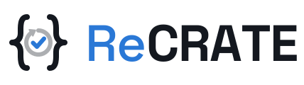
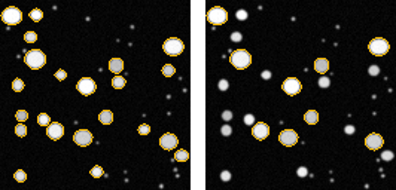

<p align="center">
  <picture>
    <source media="(prefers-color-scheme: dark)" srcset="docs/img/logo-dark.svg">
    
  </picture>
</p>

<p align="center"><b>A paper as an agent you can trust: it checks the paper's results before you rely on them, checks your data before you reuse the method, and records every run.</b></p>

<p align="center">Reproduce · Reuse · Record</p>

---

[Paper2Agent](https://github.com/jmiao24/Paper2Agent) (*Nature*, September 2026) showed that a paper's code can become an agent: an MCP server whose tools run the paper's methods, each tested against the tutorial it came from, so anyone can apply them by asking. ReCRATE takes that idea and adds what reusing a method safely needs:

* **Checked against the paper.** A tool that reproduces the authors' tutorial is not yet a check of the paper's results. ReCRATE runs each method on the paper's own data and compares it with the numbers the paper published.
* **Checked against your data.** A method applied to data unlike the paper's (another pixel size, grouping or sampling rate) can run without errors and still give a wrong answer. ReCRATE checks your data against what the method expects before it runs, and flags results far from the paper's after.
* **Recorded.** Every run leaves a standard provenance record.

To do this, ReCRATE describes the research with an [RO-Crate](https://doi.org/10.3233/DS-210053): which workflow, data, parameters and published results belong together. It uses the paper's crate when one is published, and recreates one from the paper and its code when not. Throughout, it follows the [FAIR principles for research software (FAIR4RS)](https://doi.org/10.1038/s41597-022-01710-x).

## How it works

```
paper or RO-Crate ──► research object ──────────► agent: MCP server, app chat, CLI
                      workflow, data, parameters    Reproduce · Reuse · Record
                      and published results,               │
                      declared together                    ▼
                                                    one Workflow Run RO-Crate per run
```

1. **Describe.** ReCRATE starts from a published crate (WorkflowHub, Zenodo, a folder), finds one published for the paper, or drafts one from the paper and its code with the `/recrate` agent. A drafted crate stays *draft* until a named person confirms it. From a paper, it also tells the authors' own code and data from software they only cite, clones their code (without running it), and reads which languages and packages it uses, with their versions as of publication (Python from PyPI and conda, R from CRAN).
2. **Reproduce: can I trust this result?** Each method runs on the paper's own data and every output is compared with the published value. The method climbs a ladder: *materials found* → *runs* → *same numbers* (e.g. 9/12) → *same conclusion*. When numbers differ, ReCRATE proposes follow-up checks (an inclusion rule, the rounding, a software or data version), each run and recorded on its own.
3. **Reuse: what does this method say about my data?** Your data is checked against the method's declared inputs before the run, and the results against the paper's after it. Parameters fall into three groups: adjusted automatically, with the computation shown; needing your decision, with the paper's sentence; and as published.
4. **Record: who ran what, and how do I cite it?** Every run is a Workflow Run RO-Crate linked to the paper. From it ReCRATE writes a methods paragraph, references (BibTeX, CSL-JSON), figures, and one report page a reviewer can open without installing anything. Figures come from three places, never from the model: the paper's own plotting code (a notebook's or Quarto document's plots are collected from its outputs), the figures of the paper redrawn and judged by a person, and charts asked for in the chat ("plot body mass by species, grouped by sex"), which ReCRATE's code draws from a run's table, one of the paper's tables or your data, and records in the run crate with the file and the columns plotted. Over MCP a run's figures come back as images, so a client without file access sees them. The research object's own RO-Crate, whether found, supplied, recreated as of publication or drafted, is validated with the RO-Crate validator as soon as it is created (and again whenever it changes), and exports as a zip that records how it was obtained.

## The approach: what every tool guarantees

An agent is only as trustworthy as the rules its tools follow. ReCRATE enforces these in code wherever it can:

* **Numbers come from runs, never from the model.** The model reads, routes and explains. It cannot set a published value, a tolerance or a verdict.
* **Every claim is traceable.** In a crate drafted from a paper, each parameter quotes the sentence that states it and each published value is checked against the paper's text and tables (`recrate check-description`, no model involved); and every tolerance names its source: `paper-rounding`, `paper-stated` (quoted), `method-noise` or `person` (named, with a reason). No source, no verdict on the numbers.
* **Verdicts are graded, and a person has the last word.** "Ready" never means "reproduced"; the ladder advances only on evidence from a run. *Same conclusion* is a person's call: the app and CLI require a name, and over MCP (which the app's Claude chat also uses) the tool records only a verdict the user gives in the conversation.
* **Nothing changes silently.** A parameter is adjusted only by a declared rule (`scales_with:<data property>^<exponent>`), and any other change needs a reason. Changing what is compared, such as grouping by island instead of species, is recorded as a different question, never as a reproduction.
* **The record is append-only.** Differing runs, failed runs and follow-up checks stay. Nothing replaces the first result.
* **A paper's code runs sandboxed.** The authors' scripts, notebooks and Quarto documents run in the operating system's sandbox (`sandbox-exec` on macOS, `bubblewrap` on Linux): no network, and writes only to the run's own folders, temporary files and tool caches. Without a sandbox, ReCRATE refuses to run the code; running it unsandboxed is an explicit choice (`recrate --unsandboxed …` or `RECRATE_SANDBOX=off`), and every run crate records which. A method that needs the network at run time is allowed it with `RECRATE_SANDBOX_NETWORK=1`, and a workflow engine that pulls containers or test data declares that need in its crate's invocation recipe, so the run is allowed it and the run crate says so. API keys and tokens are stripped from the environment the code sees.
* **The core is field-independent.** Field-specific knowledge lives in profiles that read properties from your files. Three exist today: `generic` (files, formats, table columns), `bioimaging` (calibration, channels, bit depth, object size) and `timeseries` (sampling rate, channels). Outputs declare a kind; scalars and tables are compared today, and other kinds are reported as not checked rather than compared the wrong way. See [docs/domain-profiles.md](docs/domain-profiles.md).

## The Paper2Agent idea, and more

ReCRATE takes the Paper2Agent idea and builds it on FAIR4RS and RO-Crate. It is its own implementation (it does not use Paper2Agent's code), but it covers what Paper2Agent does: the same way of building agents (a coordinator with specialist subagents, each tool tested before delivery) and the same interface (MCP tools that return a message and file paths). On top of that, it changes what a tool is built from and what it guarantees.

| | Paper2Agent | ReCRATE |
| --- | --- | --- |
| Description of the research | Inferred from the code | An RO-Crate: found for the paper, supplied, or recreated as of publication, and validated |
| Starts from | A paper and its code repository | The same, or an RO-Crate |
| The paper's own environment | Built per paper | Built per paper with `uv` (`recrate env`), and every run records each installed package |
| Tools come from | The code's tutorials | The paper's reported methods **and** the code's tutorials and examples |
| A tool is | A typed function, which may take data or just values | The same: a Python function named in the crate (`recrate entry`), or a script; typed parameters with their units and the paper's sentence; data optional |
| Tested against | The tutorials' outputs, not the paper's results | The paper's **published results**, with sourced tolerances and an independent verifier |
| Your data | Left to the model | Checked against the method's declared inputs; parameters rescaled only by declared rules |
| Figures | The code's plots as tools; in the chat, ad hoc plotting code, unrecorded | The same plots as tools, the paper's figures recreated and judged by a person, and any chart in the chat drawn by code from a file and recorded with its data |
| Provenance | Not recorded | A Workflow Run RO-Crate per run, linked to the paper |
| Where you use it | Claude Code, or a hosted server | Claude Desktop, Claude Code or any MCP client (`recrate install-mcp`), over stdio or HTTP (`recrate serve --http`), and the app's chat |
| How it is built | A pipeline run in Claude Code | The same pipeline (`/recrate`), from Claude Code, `recrate build`, or one button in the app |

## Why RO-Crate

An [RO-Crate](https://doi.org/10.3233/DS-210053) is one folder with a machine-readable description of what belongs together: this workflow, these parameters, this data, this software, these published results. ReCRATE is built around it:

* **In:** the paper's crate, found (WorkflowHub, Zenodo, DataCite, the paper's code), supplied, or recreated from the paper as of its publication. It is validated with the community [RO-Crate validator](https://github.com/crs4/rocrate-validator) as soon as it exists.
* **Out:** one Workflow Run RO-Crate per run, linked to the paper's crate.
* **Why it matters:** with a crate, "reproduce" has one meaning: run this workflow on this data and compare with these results. Without one, an agent can only guess.

## Why it is FAIR

* **Findable:** everything starts from and keeps persistent identifiers (DOIs, WorkflowHub and Zenodo IDs, ORCIDs), in JSON-LD that registries can index.
* **Accessible:** sources are fetched by identifier over HTTPS, and each run crate keeps the workflow and its metadata, so the record outlives the source.
* **Interoperable:** RO-Crate 1.1, Workflow RO-Crate and Workflow Run Crate, checked by the RO-Crate validator in CI.
* **Reusable:** licence and authors, data checks, parameters with units and reasons, and full provenance: who ran what, when, on which files (by checksum), with which software versions.

This follows the [FAIR principles for research software (FAIR4RS)](https://doi.org/10.1038/s41597-022-01710-x) as a proof of concept, not a certification. Principle by principle, with what is still partial: [docs/fair4rs.md](docs/fair4rs.md).

## Examples

**Nuclei segmentation** ([WorkflowHub #771](examples/workflowhub-nuclei-segmentation/), Galaxy, imaging). **Same numbers 1/1.** ReCRATE reads the method from the workflow and its published test, and runs it without a Galaxy server through ports of the Galaxy tools at their pinned versions. Any other Galaxy workflow runs on a Galaxy server through its API (`pip install "recrate[galaxy]"`, then `GALAXY_URL` and `GALAXY_API_KEY`, for example usegalaxy.eu): the inputs are uploaded, the workflow invoked, its outputs downloaded and compared with the published test, and the run crate names the server and the history. It finds the test's 20 nuclei, with the same label image pixel for pixel, and 425, 413 and 307 nuclei on three full fields of public images ([Zenodo](https://doi.org/10.5281/zenodo.3362976)). Readiness is *ready-with-gaps*: the research states no pixel size.

**Penguin size dimorphism** ([Gorman et al. 2014, *PLOS ONE*](examples/penguins-dimorphism/), ecology, tables). **Same numbers 9/12.** Recomputing Table 2 from the open data, three chinstrap values differ: culmen length −0.097 vs −0.11, flipper length −0.043 vs −0.05, body mass −0.117 vs −0.10. The paper excludes pairs whose second egg was never observed, and gives n = 54 chinstraps. Applying that exclusion as a follow-up check leaves 27 males and 27 females, and all 12 values match. Both runs stay on record; whether the conclusion holds is for a person to say. One caveat: the ±0.006 margin is 0.001 wider than rounding alone, and `check-description` says so. At ±0.005 the counts are 6/12 and 10/12.

*The paper's figures, too.* A second method redraws Figures 3–5 (stable isotopes by sex and year) from the same data, as the captions describe them, and Validate shows each next to the original for a person to judge (same / differs / can't tell, recorded in the run crate). Figure 3 comes back with the same pattern every year. Two things don't: the captions' sample sizes (Adélie n = 127 and 128; the data gives 139, or 126 with the clutch exclusion), compared exactly, and a narrower inner error bar that the captions never explain. Any method can do this: it writes `figures/figure-3.png`, and ReCRATE pairs it with the paper's Figure 3.

**StarDist nuclei detection** ([Schmidt et al. 2018, *arXiv*](examples/stardist-nuclei/), imaging, the app's paper example). **Same numbers 3/9.** Running the model trained in the paper on its 50 DSB2018 test images gives Table 1's average precision exactly at three IoU thresholds; the other six differ by at most 0.006 (0.8648 against 0.8641 at IoU 0.5), likely from newer TensorFlow and stardist. The tolerance is the paper's rounding, so the verdict says *differences found*. Reuse then fetches a second public dataset of the same kind, [BBBC039](https://bbbc.broadinstitute.org/BBBC039) (200 U2OS nuclei images with ground truth), from **Reuse → From a link**: average precision is 0.912 at IoU 0.5 and 0.299 at 0.9, against the paper's 0.864 and 0.119 on its own data, and 22,438 nuclei found against 23,615 in the ground truth. The app shows the paper's images and yours side by side, with the outlines the model drew. DSB2018 drew in part on Broad (BBBC) image collections, so BBBC039 may not be fully independent of the training data.

**Reuse at half resolution** ([make_half_resolution.py](examples/workflowhub-nuclei-segmentation/make_half_resolution.py)). Average each 2×2 block of pixels, as from a binned camera. With the published 3-pixel filter the workflow still runs, but neighbouring nuclei merge: 385, 385 and 281 nuclei. ReCRATE warns before the run (the filter is in pixels, and no pixel size is stated) and after it (objects are 0.41× the size found on the paper's data). With `--pixel-ratio 2` the filter becomes 1.5 pixels, the change is recorded with its rule, and the counts are 425, 414 and 306.



## Quick start

Needs Python 3.10 or later.

```bash
git clone https://github.com/biaperotto/recrate.git && cd recrate
python3 -m venv .venv && source .venv/bin/activate
pip install -e ".[app,mcp]"       # or, with the exact versions tested: pip install -r requirements.lock -e . --no-deps
streamlit run app/app.py          # the app: press Start, or Try an example
```

Or from the command line:

```bash
recrate agentify --crate examples/workflowhub-nuclei-segmentation/crate --out agents/nuclei
```

**In Claude or any MCP client.** No API key needed: ReCRATE runs the methods, and the model is your client's. As in Paper2Agent, one command registers the agent and checks that it starts:

```bash
recrate install-mcp agents/nuclei --client desktop   # Claude Desktop, then quit and reopen it
recrate install-mcp agents/nuclei --client project   # .mcp.json here: Claude Code and its VS Code extension
recrate install-mcp agents/nuclei                    # print the JSON for any other client
```

It launches the server with this environment's Python and absolute paths, so it does not depend on your PATH or working directory. It keeps the client's other settings, backs up its config, then starts the server over stdio as the client will, and calls its tools.

Then ask, for example, *"Reproduce this paper"*, *"Check my images in ./data, then run the method on them"* or *"Plot the counts per image."*

**Shared over HTTP.** `recrate serve agents/nuclei --http` serves the agent at `http://127.0.0.1:8765/mcp`, so any MCP client can use it without cloning anything (as Paper2Agent's hosted servers are). Register a running server with `recrate install-mcp agents/nuclei --client desktop --transport http --url http://127.0.0.1:8765/mcp`, which checks it by connecting. The server runs the paper's code on its machine, so it binds to localhost unless you say otherwise; to share it, start it with `--token <secret>` (or `RECRATE_MCP_TOKEN`) and every request must carry `Authorization: Bearer <secret>`, which `install-mcp --token` writes into the client's config.

**Workflows that need containers.** Most published pipelines run their tools in Linux containers (docker, singularity, apptainer), which a Mac cannot run by itself. `recrate runtime setup` makes a small Linux VM once (Lima, in user space, no administrator rights: about 100 MB plus a 600 MB image) with docker, apptainer, Nextflow, Snakemake and cwltool inside; from then on a workflow whose runtime this computer lacks runs in that VM on its own, and its outputs come back into the run crate. `recrate runtime status` and `recrate runtime remove` do what they say.

**From a paper alone.** In the app, add the paper and press **Make runnable**, or run `recrate build agents/<paper>` after `recrate agentify --paper <pdf> --out agents/<paper>`, or use `/recrate <paper>` in Claude Code. In each case Claude, on your subscription, runs the pipeline:

1. It clones the code and builds the paper's own environment.
2. It turns the reported methods, the code's tutorials and its plots into tools: a thin function around the authors' code, with no boilerplate, or a script.
3. It runs each tool on the published data and compares it with the published results.
4. An independent verifier checks every claim.

The result is an agent you can use in the app or serve as above. It runs the paper's code on your computer, as Paper2Agent does, so start it only for code you are willing to run. See [docs/architecture.md](docs/architecture.md).

**In the app.** `streamlit run app/app.py`, then press **Start** (or **Try an example**) and give a paper or an RO-Crate. Each research object appears in the **Research Objects** sidebar with its files, its RO-Crate's validation and a download. The chat suggests questions from the paper's content and answers with Claude when Claude Code (or its VS Code extension) is signed in, with no API key; otherwise with a local model ([Ollama](https://ollama.com)), an API key, or simple commands. Choose under **Agent**.

**From the command line**, every step runs without a model:

```bash
recrate check     agents/nuclei <your-images> --pixel-ratio 2                     # does my data fit?
recrate run       agents/nuclei <your-images> --pixel-ratio 2 --who "Your name"   # reuse, recorded
recrate agentify  --paper examples/penguins-dimorphism/paper.pdf --crate examples/penguins-dimorphism/crate --out agents/penguins
recrate followup  agents/penguins --run exclude-pairs-that-did-not-complete-their-clutch --who "Your name"
recrate review    agents/penguins --who "Your name" --agrees partly --note "..."  # same conclusion?
recrate report    agents/penguins                                                # one HTML page
recrate export-crate agents/penguins                                           # its RO-Crate, as a zip
recrate check-crate  agents/penguins                                           # the RO-Crate validator's verdict
```

## Limits and next steps

ReCRATE is a proof of concept, built at the *Reinvent the Wheel* hackathon (London, October 2026).

| Today | Next |
| --- | --- |
| Python code runs in the paper's own virtual environment (`uv`), with every package recorded. R, Quarto and shell code use the interpreters on your computer (R packages are listed with their versions as of publication, but not installed for you). The code runs sandboxed (no network; writes only to the run's folders), but it can still read your files | R environments built per paper, and containers, so the code sees only its own files |
| WorkflowHub crates: most are registered without a paper or a test, so there is nothing published to compare a run with. ReCRATE says so: such a method is *reusable, not reproducible* (it runs, checks your data and records each run). Galaxy workflows run through ported tools, or through a Galaxy server's API; nf-core (Nextflow), CWL and Snakemake crates are read through adapters that use their own conventions (`nextflow_schema.json`, the test profile and the nf-test snapshot; FormalParameters and cwltest files; `config/` and `.test/`), their published test as the expected result (Planemo outputs by sha1, nf-test snapshots by md5). A Nextflow pipeline runs with docker, singularity or apptainer, or without any container runtime through its conda profile with conda, mamba or micromamba (each tool's environment built and cached); a Snakemake crate's own `run_test.sh` becomes the recipe (its steps in order, its preflight, its workflow profile). A pipeline that needs a runtime, a cluster or data this computer lacks runs **in ReCRATE's own Linux VM** on this computer (`recrate runtime setup`, once: Lima in user space, with docker and apptainer inside; used on its own after that) or **on another machine over SSH** (`RECRATE_REMOTE=user@host`): the workflow is copied there, run there, and the outputs come back into the run crate, with readiness reflecting that machine; for the heavy ones without such a machine, `.github/workflows/workflowhub-pipeline.yml` runs any WorkflowHub pipeline by id on a GitHub runner with docker and returns the run crates | WDL, COMPSs and KNIME; Planemo tests for more Galaxy workflows |
| Scalars and tables are compared; `timeseries` is tested on synthetic data only | IoU for label images, tests for distributions, reruns to measure method noise; genomics and single-cell profiles; OME-Zarr, IDR and OMERO sources |
| Follow-ups for software and data versions are proposed, not run | Running them in pinned environments |
| A paper alone becomes runnable as far as its code and text allow. Methods that need a GPU or cluster, very large data, restricted data or a paid API are described, not run | An evaluation on 20 to 50 papers with code (WorkflowHub entries, and Paper2Agent's own examples) |
| Deposit is manual (a ready-to-deposit zip) | Automated deposit to Zenodo and WorkflowHub |

## Citing, licence, acknowledgements

Cite ReCRATE with [CITATION.cff](CITATION.cff). Code is under the [MIT licence](LICENSE); example data keep their own licences (see each example's `SOURCE.md`).

ReCRATE takes the idea of [Paper2Agent](https://github.com/jmiao24/Paper2Agent) by Jiacheng Miao and colleagues (it does not use its code) and builds it on the FAIR principles for research software and RO-Crate, drawing on the work of the [RO-Crate](https://www.researchobject.org/ro-crate/) and [Workflow Run Crate](https://www.researchobject.org/workflow-run-crate/) communities, the [RO-Crate validator](https://github.com/crs4/rocrate-validator), [WorkflowHub](https://workflowhub.eu) and the [Galaxy imaging tools](https://github.com/BMCV/galaxy-image-analysis).
